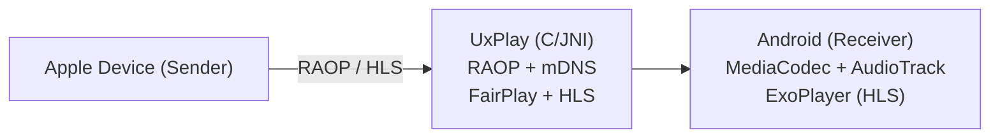

# AirBack

AirPlay receiver for Google TV and Android TV that gives you your TV back: mirror or cast from an iPhone, iPad or Mac, and when the session ends the TV returns to whatever was on before. No ads. English and Spanish.

AirBack is a fork of [jqssun/android-airplay-server](https://github.com/jqssun/android-airplay-server), the first open-source AirPlay 2 receiver for Android, which is built on [UxPlay](https://github.com/FDH2/UxPlay). Both are GPL-3.0 and so is AirBack; see [LICENSE](LICENSE). Protocol work belongs upstream, and fixes that are not branding are offered back as pull requests.

What AirBack changes on top of upstream:

- The receiver is named after the TV's own device name on first launch, so two receivers on one network never collide.
- The display wakes and the receiver comes forward the moment a sender connects, over the screensaver or a live TV input.
- Auto-restore on disconnect: when the last sender drops, the TV goes back to the previous input or app.
- Spanish localization.

DRM-protected video (Apple TV+, Netflix, Disney+) cannot be received by any third-party AirPlay receiver, AirBack included.

## Compatibility

- Android 7.0+, including Android TV
- AirPlay devices on the same subnet, including iOS/iPadOS, macOS devices, or other sender implementations

## Features

- Screen mirroring with H.264 and H.265 (HEVC) video decoding
- Audio streaming with AAC-ELD, AAC-LC and ALAC audio decoding
- Video playback with support for HLS, downloads, and remote controls
- Music playback with track information, cover art, and remote controls
- Support for Android TV with directional pad navigation and seeking controls
- Support for Picture-in-Picture, automatic resolution and mode switching
- Optional PIN authentication
- Video resolution, overscan, and frame rate control
- Audio latency control and support for software decoder fallback
- Debug overlay with real-time statistics (FPS, bitrate, codec, resolution, frame count, audio volume, etc.)
- Android native media session integration with notification controls
- Wired secondary display for macOS/iPadOS devices over USB tethering

> [!WARNING]
> DRM content (e.g. from the Apple TV application) is not supported.

## Configure from ADB

On devices without a display, settings can also be changed over ADB. The receiver is protected by `android.permission.DUMP` so regular installed apps cannot change them. Values are passed as text using `--es`. Using `adb shell`:

```bash
export KEY="server_name" VALUE="Speaker"
am broadcast -n com.airback/.SettingsReceiver -a com.airback.SET_SETTING --es key "$KEY" --es value "$VALUE"
```

To list all settings with their current values as JSON:

```bash
am start -n com.airback/.MainActivity
am broadcast -n com.airback/.SettingsReceiver -a com.airback.LIST_SETTINGS
```

## Implementation

This application uses the C-based [UxPlay](https://github.com/FDH2/UxPlay) library to implement the AirPlay/RAOP protocol, with a JNI bridge to the Android application layer. Audio can be decoded via MediaCodec or a software ALAC decoder, while mirroring video is decoded via MediaCodec and rendered to a SurfaceView. HLS sessions are served through a local playlist proxy.

When using USB tethering, the Android device can act as a reliable secondary display over a wired connection. Apple devices natively support USB tethering over CDC-NCM, so on Android devices that default to RNDIS, you may need to switch to CDC-NCM over ADB:

```bash
adb shell settings put global tether_force_usb_functions 1
```



CMake is used for native C/C++ components under [`app/src/main/cpp`](app/src/main/cpp). Submodules must be initialized before building. 

```bash
git submodule update --init --recursive
./gradlew assembleDebug
```

Check out the [CI](.github/workflows/apk.yml) for more details on reproducible builds.

## Credits

- [UxPlay](https://github.com/FDH2/UxPlay) for the AirPlay/RAOP server implementation
- [FFmpeg](https://ffmpeg.org) for the lossless audio decoder
- [Next Player](https://github.com/anilbeesetti/nextplayer) for the video player

---

Disclaimer: This project is not affiliated with Apple Inc.
